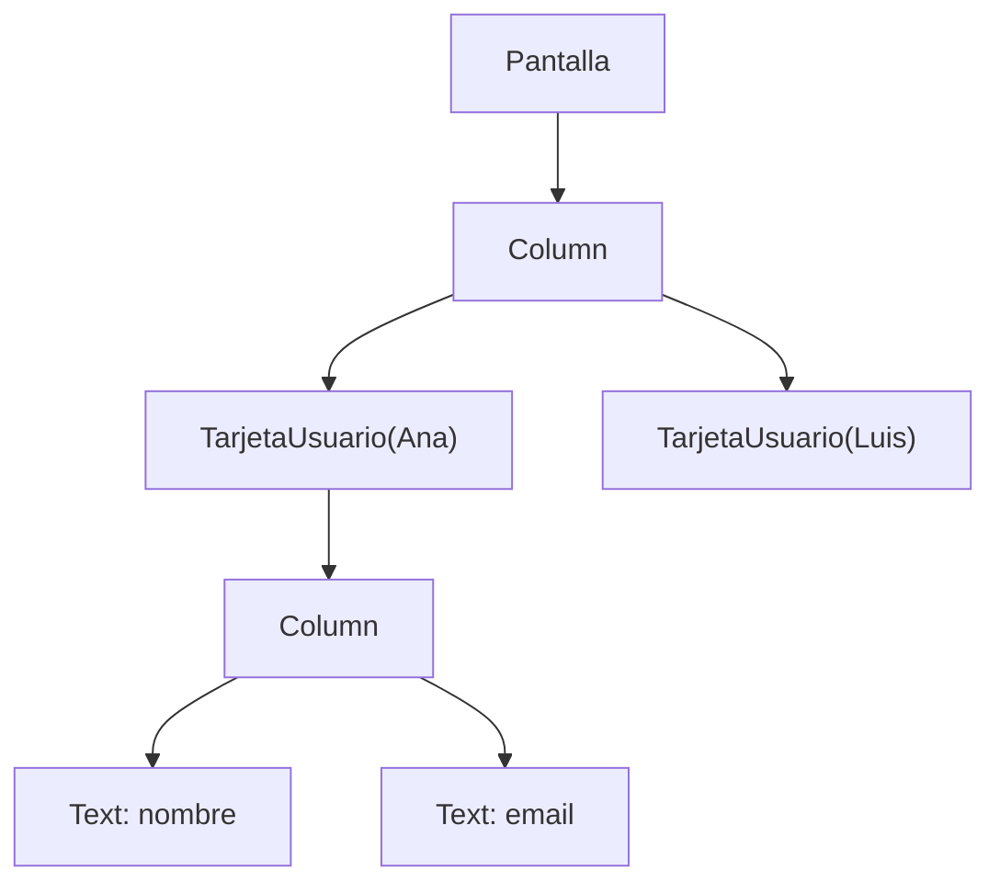

import NextPageButton from '@site/src/components/NextPageButton';

# Composables: qué son y cómo se invocan

Hasta ahora la interfaz de las aplicaciones de ejemplo se ha dado por hecha (`setContentView(R.layout.activity_main)`, un XML con vistas). En este tema entramos de lleno en **Jetpack Compose**, el toolkit moderno de Android para construir interfaces, y en el que se apoyará el resto del curso.

La diferencia de fondo con lo que se conoce del módulo de Programación es esta: en Java, una interfaz gráfica (por ejemplo con Swing) se construye **creando objetos e imperativamente añadiéndolos unos a otros**. En Compose, una interfaz se **describe** con funciones: se declara qué aspecto debe tener la pantalla para un estado dado, y el framework se encarga de dibujarlo.

---

## De Swing a Compose: dos formas de pensar la interfaz

En Java con Swing, construir un botón dentro de un panel se parece a esto:

```java
JPanel panel = new JPanel();
JButton boton = new JButton("Pulsa aquí");
boton.addActionListener(e -> System.out.println("¡Pulsado!"));
panel.add(boton);
```

Fijaos en el patrón: se **crea un objeto** (`new JButton(...)`), se **configura** modificándolo (`addActionListener`), y se **añade** a un contenedor (`panel.add(...)`). Es código imperativo: una secuencia de instrucciones que van montando la interfaz paso a paso, como si se construyera un mueble pieza a pieza.

En Compose, lo equivalente es:

```kotlin
Button(onClick = { println("¡Pulsado!") }) {
    Text("Pulsa aquí")
}
```

No hay `new`, no hay `.add()`, no hay una variable `boton` que se vaya configurando. Hay una **función**, `Button`, a la que se le pasa lo que necesita saber (qué hacer cuando se pulsa) y lo que debe contener (el texto). El resultado en pantalla es una consecuencia de **llamar a esa función**, no de ir mutando un objeto.

:::note
Declarativo vs. imperativo
Esta es la distinción clave del tema. Imperativo (Swing, las Views clásicas de Android): programas *el proceso* para llegar a la interfaz. Declarativo (Compose): programas *el resultado* que quieres ver, y el framework decide cómo llegar a él. Es el mismo cambio de mentalidad que hay entre "escribir un bucle para sumar una lista" y "usar `.sum()`".
:::

---

## Un composable no es más que una función

Cualquier bloque reutilizable de interfaz en Compose es una **función marcada con `@Composable`**. `Button`, `Text`, `Column`... todos son funciones normales de Kotlin, solo que anotadas de una forma especial que le dice al compilador "esta función describe interfaz de usuario".

```kotlin
@Composable
fun Saludo(nombre: String) {
    Text(text = "Hola, $nombre")
}
```

Esto es análogo a un método `private void dibujarSaludo(String nombre)` en Java que actualizara unas vistas, con una diferencia importante: en Java ese método **muta objetos que ya existen** (`label.setText(...)`); en Compose, la función `Saludo` **describe** lo que debe aparecer, y Compose decide cuándo y cómo dibujarlo o redibujarlo.

Al igual que cualquier función de Kotlin, un composable puede llamar a otros composables dentro de su cuerpo, recibir parámetros y tener valores por defecto. La única regla especial es que un composable **solo puede llamarse desde dentro de otro composable** (o desde el punto de entrada que conecta Compose con la Activity, que se verá en unidades posteriores).

---

## Anatomía de una llamada: `Button(...) { ... }`

Cuando se escribe algo como:

```kotlin
Button(onClick = { /* acción */ }) {
    Text("Pulsa aquí")
}
```

conviene distinguir con claridad sus dos partes, porque a primera vista puede parecer una sintaxis extraña si se viene de Java.

### Los paréntesis `( )`: los parámetros de la función

`Button` es una función y, como cualquier función, recibe **parámetros con nombre**. El más importante en este caso es `onClick`, una función lambda que se ejecuta cuando el usuario pulsa el botón:

```kotlin
Button(
    onClick = { println("Pulsado") },
    enabled = true,
    modifier = Modifier.padding(8.dp)
)
```

Esto no es distinto, en el fondo, de una llamada normal a un método con parámetros nombrados en Kotlin. Si viene de Java, la única novedad real es la sintaxis de **parámetros con nombre** (`onClick = ...`), que Java no tiene de forma nativa: en Java habría que simular esto con un patrón *builder* o sobrecargando el constructor.

### Las llaves `{ }`: el último parámetro, que también es una función

Aquí está el punto que más confunde al principio. En:

```kotlin
Button(onClick = { ... }) {
    Text("Pulsa aquí")
}
```

el bloque `{ Text("Pulsa aquí") }` **no es un bloque de código suelto**: es también un parámetro de la función `Button`, concretamente el parámetro `content`, que es una función lambda de tipo `@Composable () -> Unit` (es decir, "una función sin parámetros que no devuelve nada, pero que puede contener composables").

En Kotlin existe una regla llamada ***trailing lambda***: si el **último parámetro** de una función es una lambda, se puede sacar fuera de los paréntesis y escribirla como un bloque `{ }` justo después. Por eso el código anterior es exactamente equivalente a:

```kotlin
Button(onClick = { ... }, content = { Text("Pulsa aquí") })
```

:::tip
Una forma de verlo con ojos de Java
Imaginad una interfaz funcional `ContenidoUI` con un único método `dibujar()`, y un método `crearBoton(Runnable alPulsar, ContenidoUI contenido)`. Llamarlo sería `crearBoton(() -> accion(), () -> dibujarTexto())`. Kotlin permite, cuando el último argumento es una función, escribirlo como un bloque aparte tras el paréntesis. Es azúcar sintáctico sobre una idea que Java también tiene (lambdas, interfaces funcionales) pero sin esta última facilidad de escritura.
:::

Por eso `Button` "acepta contenido dentro": lo que hay entre las llaves es la lambda que describe qué composables dibujar **dentro** del botón. Se podría poner un `Row` con un icono y un texto, en vez de un simple `Text`, y seguiría siendo válido:

```kotlin
Button(onClick = { /* acción */ }) {
    Icon(Icons.Default.Favorite, contentDescription = null)
    Spacer(modifier = Modifier.width(4.dp))
    Text("Me gusta")
}
```

---

## Componer funciones: la unidad básica de reutilización

Igual que en Java se extrae un método privado para no repetir código, en Compose se extrae un **composable propio** para no repetir interfaz:

```kotlin
@Composable
fun TarjetaUsuario(nombre: String, email: String) {
    Column {
        Text(text = nombre)
        Text(text = email)
    }
}

@Composable
fun Pantalla() {
    Column {
        TarjetaUsuario(nombre = "Ana", email = "ana@example.com")
        TarjetaUsuario(nombre = "Luis", email = "luis@example.com")
    }
}
```

Una interfaz completa en Compose es, en el fondo, un **árbol de llamadas a funciones composables**, unas dentro de otras. Este árbol se llama con frecuencia *árbol de composición*, y es la estructura que Compose recorre para saber qué dibujar y, más adelante en el curso, qué volver a dibujar cuando cambian los datos (*recomposición*).



:::warning
No confundir con anidar Views en XML
El resultado visual puede recordar a anidar `<LinearLayout>` dentro de otro en un XML clásico de Android, pero la mecánica es distinta: aquí no se está construyendo un árbol de objetos que luego se infla, se están **llamando funciones normales de Kotlin**, con todo lo que eso permite: condicionales, bucles, variables locales, funciones auxiliares... cosas mucho más incómodas de expresar en un XML estático.
:::

<NextPageButton to="/tema-3/b-componentes-estructura">
Componentes de estructura: Box, Row, Column y las variantes Lazy
</NextPageButton>
