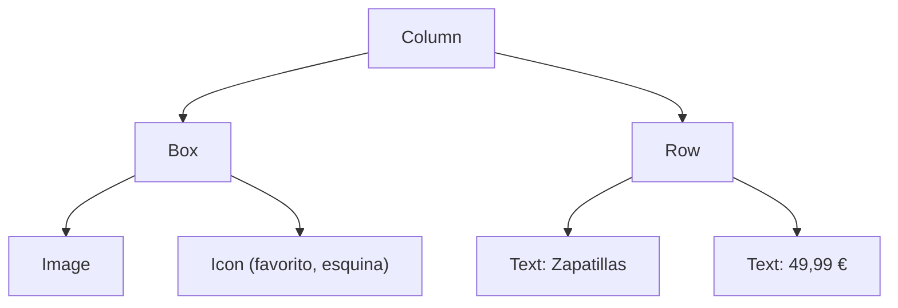

import NextPageButton from '@site/src/components/NextPageButton';

# Componentes de estructura: organizar la pantalla

Ya sabemos cómo se invoca un composable. El siguiente paso es aprender a **colocar varios composables en pantalla**: unos al lado de otros, unos encima de otros, o en listas que pueden tener cientos de elementos. Para eso existen los **componentes de estructura** (o de *layout*): no dibujan nada por sí mismos, su trabajo es organizar a sus hijos.

Es el equivalente conceptual a `LinearLayout`, `FrameLayout` y `RecyclerView` en el sistema de Views clásico, pero con una API mucho más directa.

---

## `Column`: apilar de arriba a abajo

`Column` coloca a sus hijos **uno debajo de otro**, en vertical.

```kotlin
Column {
    Text("Primera línea")
    Text("Segunda línea")
    Text("Tercera línea")
}
```

<div style={{textAlign: 'center'}}>
  
</div>

Los parámetros `verticalArrangement` y `horizontalAlignment` controlan cómo se distribuyen y alinean los hijos dentro del espacio disponible:

```kotlin
Column(
    verticalArrangement = Arrangement.SpaceBetween,
    horizontalAlignment = Alignment.CenterHorizontally
) {
    Text("Arriba")
    Text("Abajo")
}
```

---

## `Row`: colocar en horizontal

`Row` es el equivalente horizontal de `Column`: coloca a sus hijos **uno al lado de otro**.

```kotlin
Row {
    Icon(Icons.Default.Star, contentDescription = null)
    Text("Favorito")
}
```

<div style={{textAlign: 'center'}}>
  
</div>

Igual que `Column`, admite `horizontalArrangement` (cómo se reparte el espacio horizontal: al inicio, centrado, con huecos iguales...) y `verticalAlignment` (cómo se alinean verticalmente los hijos, que pueden tener alturas distintas).

:::tip
Truco mnemotécnico
`Column` apila en **columna** (vertical). `Row` coloca en **fila** (horizontal). El nombre del parámetro de arranque indica el eje que controla: `verticalArrangement` en `Column` reparte el espacio en el eje en el que apila; `horizontalArrangement` en `Row`, igual.
:::

---

## `Box`: superponer capas

`Box` coloca a todos sus hijos **en el mismo espacio, unos encima de otros**, como capas. Es la herramienta para superponer un texto sobre una imagen, o un icono en la esquina de una tarjeta.

```kotlin
Box {
    Image(painter = imagenFondo, contentDescription = null)
    Text(
        text = "Título",
        modifier = Modifier.align(Alignment.BottomStart)
    )
}
```

<div style={{textAlign: 'center'}}>
  
</div>

Cada hijo de un `Box` puede posicionarse de forma independiente con `Modifier.align(...)`, algo que no tiene sentido en `Row` o `Column` (donde los hijos se colocan en secuencia, uno tras otro).

---

## Combinando los tres

La inmensa mayoría de pantallas se construyen anidando estos tres componentes. Por ejemplo, una tarjeta de producto con imagen, y debajo nombre y precio en la misma línea:

```kotlin
Column {
    Box {
        Image(painter = imagenProducto, contentDescription = null)
        Icon(
            Icons.Default.Favorite,
            contentDescription = "Favorito",
            modifier = Modifier.align(Alignment.TopEnd)
        )
    }
    Row(horizontalArrangement = Arrangement.SpaceBetween) {
        Text("Zapatillas")
        Text("49,99 €")
    }
}
```



---

## Las variantes *Lazy*: listas largas

`Column` y `Row` tienen un problema: **componen todos sus hijos de golpe**, aunque la pantalla solo pueda mostrar unos pocos. Poner 500 elementos dentro de una `Column` dentro de un scroll significa crear los 500 composables aunque el usuario solo vea 6. Es el mismo problema que resolvía `RecyclerView` frente a un `LinearLayout` con scroll en el sistema de Views clásico, y Compose lo resuelve de forma parecida.

### `LazyColumn`

Es el equivalente perezoso (*lazy*) de `Column`: solo compone los elementos que son (o van a ser pronto) visibles en pantalla, y los recicla al hacer scroll.

```kotlin
LazyColumn {
    items(listaDeProductos) { producto ->
        Text(text = producto.nombre)
    }
}
```

Nótese la diferencia de forma respecto a `Column`: no se escriben los hijos directamente dentro del bloque `{ }`, sino que se usa la función `items(...)`, a la que se le pasa la lista de datos y una lambda que describe **cómo dibujar un elemento**. Esto es deliberado: Compose necesita saber cuántos elementos hay y cómo generarlos bajo demanda, no puede recibir 500 composables ya creados.

### `LazyRow`

Igual que `LazyColumn`, pero en horizontal. Es el patrón típico de un carrusel de imágenes o una lista de categorías que se desplaza lateralmente:

```kotlin
LazyRow {
    items(categorias) { categoria ->
        Text(text = categoria, modifier = Modifier.padding(8.dp))
    }
}
```

<div style={{textAlign: 'center'}}>
  
</div>

:::note
¿Cuándo usar la versión *Lazy* y cuándo la normal?
Regla práctica: si la lista de elementos es **fija y corta** (unos pocos campos de un formulario, un menú con 4 opciones), `Column`/`Row` normales son más simples y suficientes. Si los elementos vienen de una **colección de datos** que puede crecer (resultados de una búsqueda, un listado de contactos, un feed), la versión *Lazy* es la elección correcta casi siempre.
:::

---

## Tabla resumen

| Componente | Organiza en... | Compone todo de golpe | Equivalente clásico |
|---|---|---|---|
| `Column` | Vertical | Sí | `LinearLayout` vertical |
| `Row` | Horizontal | Sí | `LinearLayout` horizontal |
| `Box` | Superpuesto (capas) | Sí | `FrameLayout` |
| `LazyColumn` | Vertical | No (perezoso) | `RecyclerView` vertical |
| `LazyRow` | Horizontal | No (perezoso) | `RecyclerView` horizontal |

<NextPageButton to="/tema-3/c-componentes-comunes">
Componentes comunes: Button, TextField y otros controles
</NextPageButton>
