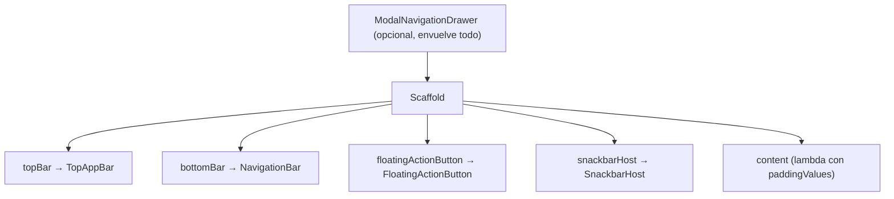

import NextPageButton from '@site/src/components/NextPageButton';

# Scaffold: la estructura completa de una pantalla

Ya conocemos las piezas: composables de estructura (`Column`, `Row`, `Box`) y componentes ya hechos (`Button`, `TextField`...). Pero casi cualquier aplicación real comparte un mismo **esqueleto de pantalla**: una barra superior con el título, quizás un menú lateral, el contenido en medio, quizás una barra inferior de navegación, un botón flotante para la acción principal, y un mensaje temporal (*snackbar*) quc aparece de vez en cuando.

Montar ese esqueleto a mano cada vez sería repetitivo y fácil de hacer mal (por ejemplo, olvidando dejar espacio para que el contenido no quede tapado por la barra superior). Para eso existe `Scaffold`: un composable que **ya sabe organizar estas piezas** y solo pide que se le indique qué poner en cada hueco.

---

## La forma general

```kotlin
Scaffold(
    topBar = { /* barra superior */ },
    bottomBar = { /* barra inferior */ },
    floatingActionButton = { /* botón flotante */ },
    snackbarHost = { /* mensajes temporales */ }
) { paddingValues ->
    // Contenido principal de la pantalla
    Column(modifier = Modifier.padding(paddingValues)) {
        Text("Contenido de la pantalla")
    }
}
```

```
┌─────────────────────────────┐
│         topBar                │
├─────────────────────────────┤
│                                │
│                                │
│         contenido               │
│                            (FAB)│
│                                │
├─────────────────────────────┤
│         bottomBar              │
└─────────────────────────────┘
```

Nótese la firma: `Scaffold` recibe varios parámetros con nombre (las distintas zonas) y, como último parámetro (*trailing lambda*, visto en la primera página del tema), el contenido principal — con la particularidad de que ese lambda recibe un argumento, `paddingValues`, con el espacio que hay que respetar para no invadir las barras.

:::warning
Aplicar siempre el `paddingValues`
Si no se aplica `Modifier.padding(paddingValues)` al contenido, este puede quedar dibujado por debajo de la barra superior o por encima de la inferior, tapado y con partes no accesibles. Es el error más común al empezar a usar `Scaffold`.
:::

---

## `topBar`: la barra superior

Normalmente se rellena con `TopAppBar` (o `CenterAlignedTopAppBar`), que ya trae título, y huecos para un icono de navegación (por ejemplo, la flecha de "atrás") y acciones a la derecha:

```kotlin
Scaffold(
    topBar = {
        TopAppBar(
            title = { Text("Mi aplicación") },
            navigationIcon = {
                IconButton(onClick = { /* abrir menú o volver atrás */ }) {
                    Icon(Icons.Default.Menu, contentDescription = "Abrir menú")
                }
            },
            actions = {
                IconButton(onClick = { /* buscar */ }) {
                    Icon(Icons.Default.Search, contentDescription = "Buscar")
                }
            }
        )
    }
) { padding -> /* ... */ }
```

```
┌─────────────────────────────┐
│ ☰   Mi aplicación        🔍  │
└─────────────────────────────┘
```

---

## `bottomBar`: navegación inferior

Se usa cuando la aplicación tiene **varias secciones principales** entre las que el usuario cambia constantemente (por ejemplo, "Inicio", "Buscar", "Perfil"). Se construye con `NavigationBar`, que contiene varios `NavigationBarItem`:

```kotlin
Scaffold(
    bottomBar = {
        NavigationBar {
            NavigationBarItem(
                selected = pantallaActual == "inicio",
                onClick = { pantallaActual = "inicio" },
                icon = { Icon(Icons.Default.Home, contentDescription = null) },
                label = { Text("Inicio") }
            )
            NavigationBarItem(
                selected = pantallaActual == "perfil",
                onClick = { pantallaActual = "perfil" },
                icon = { Icon(Icons.Default.Person, contentDescription = null) },
                label = { Text("Perfil") }
            )
        }
    }
) { padding -> /* ... */ }
```

```
┌─────────────────────────────┐
│                                │
│         contenido               │
│                                │
├─────────────────────────────┤
│   🏠           👤              │
│  Inicio        Perfil          │
└─────────────────────────────┘
```

:::note
Esto todavía no es navegación de verdad
De momento, cambiar `pantallaActual` y mostrar un `Column` u otro según su valor es suficiente para practicar la forma del componente. La navegación real entre pantallas, con el Navigation Component ya mencionado en el tema 2, se trabajará en profundidad en la unidad 3 del curso.
:::

---

## El menú lateral: `ModalNavigationDrawer`

Cuando las secciones son demasiadas para caber en una barra inferior, o se prefiere un patrón distinto, se usa un **menú lateral** (*navigation drawer*) que se desliza desde el borde de la pantalla. A diferencia de las demás piezas, no es un parámetro de `Scaffold`: es un composable que **envuelve** a todo el `Scaffold`:

```kotlin
ModalNavigationDrawer(
    drawerContent = {
        ModalDrawerSheet {
            Text("Menú", modifier = Modifier.padding(16.dp))
            NavigationDrawerItem(
                label = { Text("Ajustes") },
                selected = false,
                onClick = { /* navegar */ }
            )
        }
    }
) {
    Scaffold(
        topBar = { /* con un icono de hamburguesa que abra el drawer */ }
    ) { padding -> /* contenido */ }
}
```

```
┌──────────┬──────────────────┐
│  Menú     │  ☰  Mi aplicación │
│ ─────    ├──────────────────┤
│ Ajustes   │                    │
│ Perfil    │     contenido       │
│ Salir     │                    │
└──────────┴──────────────────┘
   (desplegado desde el borde)
```

El icono de "hamburguesa" (`Icons.Default.Menu`) que se colocó antes en `navigationIcon` del `topBar` es, típicamente, el que dispara la apertura de este menú.

---

## `floatingActionButton`: el botón flotante

Representa **la acción más importante de la pantalla**, la que el diseño quiere destacar por encima de cualquier otra: añadir un elemento nuevo, componer un mensaje, tomar una foto. Se coloca "flotando" sobre el contenido, normalmente en la esquina inferior derecha:

```kotlin
Scaffold(
    floatingActionButton = {
        FloatingActionButton(onClick = { /* añadir elemento */ }) {
            Icon(Icons.Default.Add, contentDescription = "Añadir")
        }
    }
) { padding -> /* ... */ }
```

:::tip
Una pantalla, un FAB
Al ser "la" acción destacada de la pantalla, lo habitual es que haya como mucho **un** `floatingActionButton` por pantalla. Si parece que hacen falta varios botones flotantes al mismo nivel de importancia, es una señal de que quizás ninguno debería serlo, y conviene replantear qué es la acción principal.
:::

---

## `snackbarHost`: mensajes temporales

Un *snackbar* es un aviso breve que aparece en la parte inferior de la pantalla durante unos segundos y desaparece solo (por ejemplo, "Elemento eliminado", con un botón opcional de "Deshacer"). `Scaffold` necesita un `SnackbarHostState` para saber cuándo mostrar uno:

```kotlin
val snackbarHostState = remember { SnackbarHostState() }
val scope = rememberCoroutineScope()

Scaffold(
    snackbarHost = { SnackbarHost(snackbarHostState) },
    floatingActionButton = {
        FloatingActionButton(onClick = {
            scope.launch {
                snackbarHostState.showSnackbar("Elemento añadido")
            }
        }) {
            Icon(Icons.Default.Add, contentDescription = "Añadir")
        }
    }
) { padding -> /* ... */ }
```

```
┌─────────────────────────────┐
│                                │
│         contenido               │
│                                │
│ ┌─────────────────────────┐ │
│ │ Elemento añadido   DESHACER│ │
│ └─────────────────────────┘ │
└─────────────────────────────┘
```

:::note
`rememberCoroutineScope` y `launch` se dan por sabidos aquí
Mostrar un snackbar es una operación que espera un tiempo (a que se cierre o caduque), y en Compose esas operaciones se expresan con **corrutinas**. No hace falta dominarlas todavía para copiar este patrón; se trabajarán con detalle en unidades posteriores del curso.
:::

---

## Todas las piezas juntas



| Parte | Composable típico | Para qué sirve |
|---|---|---|
| `topBar` | `TopAppBar` | Título, navegación hacia atrás, acciones |
| `bottomBar` | `NavigationBar` | Cambiar entre secciones principales |
| Menú lateral | `ModalNavigationDrawer` | Navegación con muchas opciones, envuelve al `Scaffold` |
| `floatingActionButton` | `FloatingActionButton` | La acción destacada de la pantalla |
| `snackbarHost` | `SnackbarHost` | Avisos breves y temporales |
| contenido | lo que se quiera (`Column`, `LazyColumn`...) | El cuerpo real de la pantalla |

<NextPageButton to="/tema-3/f-mockup-catalogo-apps">
Leer un mockup: catálogo de aplicaciones
</NextPageButton>
