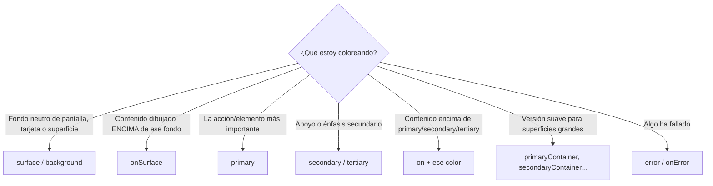

import NextPageButton from '@site/src/components/NextPageButton';

# Material 3: el sistema de color detrás de los componentes

Todos los componentes vistos en la página anterior (`Button`, `TextField`, `Switch`...) ya tienen un aspecto visual concreto: colores, formas redondeadas, tipografía. Eso no es casualidad ni un estilo "por defecto" arbitrario: viene de **Material 3** (también llamado *Material You*), el sistema de diseño de Google que Compose implementa de serie.

Lo importante para programar con Compose no es memorizar la paleta de Material 3, sino entender **de dónde salen esos colores y qué papel cumple cada uno**, porque son los nombres que se van a usar constantemente al personalizar un `MaterialTheme`.

---

## El tema como origen único de los colores

Cuando se genera un proyecto nuevo de Compose, Android Studio crea un archivo `Theme.kt` con algo así:

```kotlin
@Composable
fun MiAppTheme(
    darkTheme: Boolean = isSystemInDarkTheme(),
    content: @Composable () -> Unit
) {
    val colorScheme = if (darkTheme) DarkColorScheme else LightColorScheme

    MaterialTheme(
        colorScheme = colorScheme,
        typography = Typography,
        content = content
    )
}
```

Y en `MainActivity`, todo el contenido de la app se envuelve en ese tema:

```kotlin
setContent {
    MiAppTheme {
        // toda la interfaz de la app va aquí dentro
    }
}
```

`MaterialTheme` funciona como un **proveedor de valores** al que cualquier composable descendiente puede acceder con `MaterialTheme.colorScheme`, `MaterialTheme.typography`, etc. Por eso un `Button` normal ya sale con el color correcto sin que se le indique nada: internamente está pidiendo, por ejemplo, `MaterialTheme.colorScheme.primary`.

:::tip
No hace falta crear los colores a mano
Escribir un `ColorScheme` completo (más de 20 colores, con sus variantes claro/oscuro) a mano es tedioso y fácil de hacer mal en cuanto a contraste. Para eso existe el **Material Theme Builder**, la herramienta oficial de Google: a partir de un color de marca (o de una imagen), genera automáticamente todo el esquema de colores, en modo claro y oscuro, y permite exportarlo directamente como código Kotlin listo para pegar en `Theme.kt`.

👉 [Material Theme Builder](https://material-foundation.github.io/material-theme-builder/)
:::

---

## `on*`: el color que va *encima*

El patrón más importante para entender la paleta es el prefijo `on`. Cada color de fondo tiene su pareja `on<Color>`, que es **el color que debe usarse para lo que se dibuja encima de él** (texto, iconos) de forma que se lea con buen contraste:

```
┌─────────────────────────────┐
│  primary (fondo del botón)   │
│                                │
│      onPrimary (el texto)     │
└─────────────────────────────┘
```

```kotlin
Box(
    modifier = Modifier.background(MaterialTheme.colorScheme.primary)
) {
    Text(
        text = "Confirmar",
        color = MaterialTheme.colorScheme.onPrimary
    )
}
```

Esta es la razón por la que, al cambiar el color de marca en el Theme Builder, **nunca hay que tocar a mano el color del texto de los botones**: el propio esquema ya trae calculado el `onPrimary` con el contraste adecuado, tanto en modo claro como oscuro.

---

## Los roles principales

Material 3 no da un único color "de marca", sino tres niveles de énfasis (`primary`, `secondary`, `tertiary`), pensados para jerarquizar visualmente los elementos de una pantalla:

| Rol | Para qué se usa | Ejemplo típico |
|---|---|---|
| `primary` / `onPrimary` | La acción o elemento más destacado de la interfaz | Fondo de un `Button` principal, FAB |
| `secondary` / `onSecondary` | Elementos de apoyo, menos protagonistas que el primario | Chips seleccionados, controles secundarios |
| `tertiary` / `onTertiary` | Un acento adicional, de contraste, para llamar la atención sobre algo puntual | Etiquetas destacadas, elementos decorativos |
| `error` / `onError` | Estados de error | Texto o icono de un campo con validación fallida |

Cada uno de estos roles tiene, además, una variante **`Container`** (`primaryContainer`, `secondaryContainer`...): una versión más suave y de menor contraste del mismo color, pensada para superficies más grandes (la tarjeta completa de un elemento seleccionado, por ejemplo) donde el tono intenso del color base resultaría demasiado agresivo. Como toda superficie, también tiene su pareja `on`: `onPrimaryContainer`, `onSecondaryContainer`...

```kotlin
Card(
    colors = CardDefaults.cardColors(
        containerColor = MaterialTheme.colorScheme.primaryContainer,
        contentColor = MaterialTheme.colorScheme.onPrimaryContainer
    )
) {
    Text("Elemento seleccionado")
}
```

---

## `surface`: el fondo de la propia pantalla

Mientras que `primary`/`secondary`/`tertiary` son colores para **destacar** algo puntual, `surface` es el color base neutro sobre el que se apoya casi todo lo demás: el fondo de una pantalla, de una `Card`, de un `Scaffold`.

| Color | Para qué se usa |
|---|---|
| `surface` / `onSurface` | Fondo neutro por defecto (pantallas, tarjetas) y el texto/iconos principales sobre él |
| `surfaceVariant` / `onSurfaceVariant` | Una variación sutil de `surface`, útil para diferenciar zonas sin recurrir a un color de marca (por ejemplo, el fondo de un `TextField`) |
| `background` / `onBackground` | El fondo general de la app (en la práctica, en Material 3 suele coincidir visualmente con `surface`) |
| `outline` | Bordes y separadores sutiles (el contorno de un `OutlinedButton` o un `OutlinedTextField`) |

:::note
`surface` es el color que se usa "por defecto"
Si no se especifica nada, la mayoría de componentes contenedores (`Card`, `Scaffold`, `Surface`...) toman `surface` como fondo y `onSurface` como color de su contenido. Los colores `primary`/`secondary`/`tertiary` se reservan para cuando de verdad se quiere que algo destaque sobre ese fondo neutro, no para pintar toda la pantalla.
:::

---

## Resumen: cómo elegir el color correcto



| Pregunta | Color a usar |
|---|---|
| ¿Es el fondo neutro por defecto de una pantalla o tarjeta? | `surface`, `background` |
| ¿Es texto o icono dibujado sobre ese fondo neutro? | `onSurface` |
| ¿Es la acción más importante de la pantalla? | `primary` |
| ¿Es texto/icono encima de un color `X`? | `onX` (`onPrimary`, `onSecondary`...) |
| ¿Necesito la misma idea pero en una superficie grande y suave? | `XContainer` (`primaryContainer`...) |
| ¿Es un estado de error? | `error` / `onError` |

En la práctica, casi nunca hace falta escribir un color "a mano" (`Color(0xFF...)`) dentro de un composable: se usa el rol de `MaterialTheme.colorScheme` que corresponda, y así toda la app cambia de aspecto (incluido el modo oscuro) con solo tocar el tema una vez.

<NextPageButton to="/tema-3/d-scaffold">
Scaffold: la estructura completa de una pantalla
</NextPageButton>
