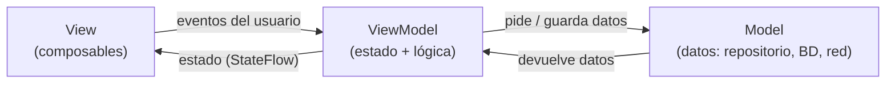
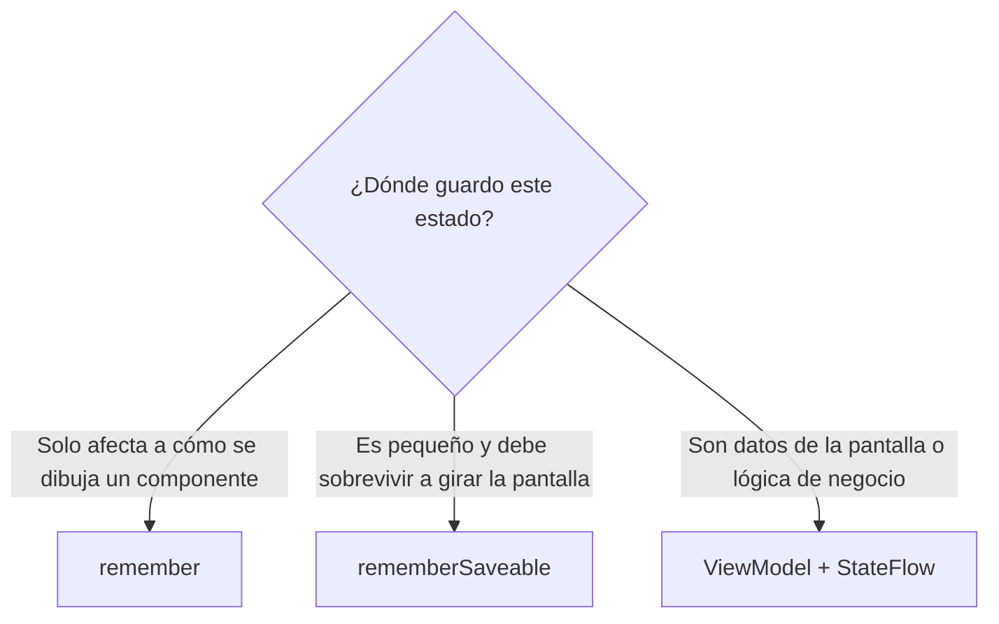

import NextPageButton from '@site/src/components/NextPageButton';

# MVVM y `remember`: dónde vive el estado de la interfaz

En las páginas anteriores ya han aparecido líneas como `var texto by remember { mutableStateOf("") }` sin explicar qué hacen. Esta página lo explica, y da el siguiente paso: cuando una pantalla tiene algo más que un campo de texto, **el estado deja de guardarse dentro del composable** y pasa a un `ViewModel`, siguiendo el patrón **MVVM**.

---

## Estado y recomposición

En Compose la interfaz es una **función del estado**: cuando el estado cambia, Compose vuelve a ejecutar los composables que lo leen para dibujarlos con el nuevo valor. A ese proceso se le llama **recomposición**.

```kotlin
@Composable
fun Contador() {
    var cuenta = 0   // ❌ no funciona

    Button(onClick = { cuenta++ }) {
        Text("Pulsado $cuenta veces")
    }
}
```

Este código tiene dos fallos:

1. Compose **no sabe** que `cuenta` ha cambiado, porque es una variable normal: no se redibuja nada.
2. Aunque se redibujara, la función se ejecuta de nuevo desde el principio y `cuenta` volvería a valer `0`.

La solución necesita dos piezas: un valor que Compose **observe** (`mutableStateOf`) y un sitio donde **guardarlo** entre recomposiciones (`remember`).

---

## `mutableStateOf` y `remember`

```kotlin
@Composable
fun Contador() {
    var cuenta by remember { mutableStateOf(0) }

    Button(onClick = { cuenta++ }) {
        Text("Pulsado $cuenta veces")
    }
}
```

| Pieza | Qué hace |
|---|---|
| `mutableStateOf(0)` | Crea un valor **observable**: cada vez que se modifica, Compose recompone los composables que lo leen |
| `remember { ... }` | **Guarda** ese valor en memoria, de modo que sobreviva a las recomposiciones en lugar de reiniciarse |
| `by` | Delegado de Kotlin que permite usar `cuenta` directamente, en vez de `cuenta.value` |

Las dos piezas van siempre juntas: sin `mutableStateOf` no hay redibujado, y sin `remember` el valor se pierde en cada recomposición.

:::note
`import androidx.compose.runtime.getValue` y `setValue`
Para poder usar `by`, hacen falta estos dos imports. Android Studio los sugiere automáticamente al escribir la línea.
:::

### `remember` no sobrevive a todo: `rememberSaveable`

`remember` guarda el valor mientras el composable permanece en la composición, pero **se pierde si la `Activity` se destruye y se vuelve a crear**; el caso típico es **girar la pantalla** (recuerda el [ciclo de vida de la Activity](/tema-2/c-ciclo-vida-activity)).

```kotlin
var texto by rememberSaveable { mutableStateOf("") }
```

`rememberSaveable` funciona igual que `remember`, pero además guarda el valor en el `Bundle` del sistema, así que **sobrevive a rotaciones** y a la muerte del proceso. Sirve para estado pequeño (textos, números, booleanos).

---

## El problema: el estado en el composable no escala

Para un contador o un campo de texto, `remember` es suficiente. Pero una pantalla real tiene:

- Una lista de datos que hay que cargar (red, base de datos).
- Reglas de negocio ("no se puede comprar si el carrito está vacío").
- Varios composables que necesitan los mismos datos.

Si todo eso vive dentro de los composables, el resultado es difícil de leer, de reutilizar y de probar. La interfaz acaba mezclando **cómo se ve** con **qué hace la app**.

---

## El patrón MVVM

**MVVM** (*Model – View – ViewModel*) separa la aplicación en tres capas, cada una con una única responsabilidad:



| Capa | Qué contiene | En Compose |
|---|---|---|
| **Model** | Los datos y su origen: clases de datos, repositorios, base de datos, llamadas a red | `data class`, repositorios |
| **ViewModel** | El **estado de la pantalla** y la lógica que lo modifica. No sabe nada de cómo se dibuja | Clase que hereda de `ViewModel` |
| **View** | Dibujar el estado actual y avisar de lo que hace el usuario. Sin lógica de negocio | Funciones `@Composable` |

La regla clave es la **dirección del flujo**: el estado baja hacia la vista, los eventos suben hacia el ViewModel. Es lo que se conoce como **flujo de datos unidireccional**.

<div style={{textAlign: 'center'}}>
  
</div>

La vista **nunca modifica el estado directamente**: solo muestra lo que recibe y, cuando el usuario hace algo, llama a una función del ViewModel.

---

## El `ViewModel`

Un `ViewModel` es una clase de Android Jetpack con una propiedad muy útil: **sobrevive a los cambios de configuración**. Si se gira el móvil, la `Activity` se recrea, pero el `ViewModel` es el mismo, y con él su estado.

Para usarlo en Compose hay que añadir la dependencia en `build.gradle.kts` (módulo `app`):

```kotlin
implementation("androidx.lifecycle:lifecycle-viewmodel-compose:2.8.7")
```

### Ejemplo completo: lista de tareas

**1. El modelo** (los datos):

```kotlin
data class Tarea(
    val id: Int,
    val titulo: String,
    val hecha: Boolean = false
)
```

**2. El estado de la pantalla**, agrupado en una sola clase:

```kotlin
data class TareasUiState(
    val tareas: List<Tarea> = emptyList(),
    val textoNueva: String = ""
)
```

**3. El ViewModel**:

```kotlin
class TareasViewModel : ViewModel() {

    private val _uiState = MutableStateFlow(TareasUiState())
    val uiState: StateFlow<TareasUiState> = _uiState.asStateFlow()

    fun onTextoCambiado(texto: String) {
        _uiState.update { it.copy(textoNueva = texto) }
    }

    fun onAnyadirTarea() {
        _uiState.update { estado ->
            val nueva = Tarea(id = estado.tareas.size, titulo = estado.textoNueva)
            estado.copy(tareas = estado.tareas + nueva, textoNueva = "")
        }
    }

    fun onTareaMarcada(id: Int) {
        _uiState.update { estado ->
            estado.copy(
                tareas = estado.tareas.map {
                    if (it.id == id) it.copy(hecha = !it.hecha) else it
                }
            )
        }
    }
}
```

Dos detalles importantes del patrón:

- **`_uiState` es privado y mutable; `uiState` es público y de solo lectura.** Así, solo el ViewModel puede cambiar el estado; la vista solo puede observarlo.
- El estado es **inmutable** (`data class` con `val`): para "modificarlo" se crea una copia con `copy(...)`. Compose detecta así con facilidad qué ha cambiado.

**4. La vista**:

```kotlin
@Composable
fun TareasScreen(viewModel: TareasViewModel = viewModel()) {
    val uiState by viewModel.uiState.collectAsState()

    Column(modifier = Modifier.padding(16.dp)) {
        Row {
            TextField(
                value = uiState.textoNueva,
                onValueChange = viewModel::onTextoCambiado,
                modifier = Modifier.weight(1f)
            )
            Button(onClick = viewModel::onAnyadirTarea) {
                Text("Añadir")
            }
        }

        LazyColumn {
            items(uiState.tareas) { tarea ->
                Row(verticalAlignment = Alignment.CenterVertically) {
                    Checkbox(
                        checked = tarea.hecha,
                        onCheckedChange = { viewModel.onTareaMarcada(tarea.id) }
                    )
                    Text(tarea.titulo)
                }
            }
        }
    }
}
```

| Línea | Qué hace |
|---|---|
| `viewModel()` | Obtiene el ViewModel de esta pantalla; Android lo crea la primera vez y lo reutiliza después (también tras girar el móvil) |
| `collectAsState()` | Convierte el `StateFlow` en un estado de Compose: cada vez que el ViewModel emite un estado nuevo, la pantalla se recompone |
| `viewModel::onTextoCambiado` | Referencia a una función del ViewModel: el evento **sube** hacia él |

Fíjate en que `TareasScreen` **no guarda nada con `remember`**: todo el estado importante está en el ViewModel.

---

## ¿`remember` o `ViewModel`?

No son alternativas excluyentes; cada uno guarda un tipo distinto de estado:

| | `remember` / `rememberSaveable` | `ViewModel` |
|---|---|---|
| **Qué guarda** | Estado **visual**, local a un composable (si un menú está desplegado, el scroll, un campo temporal) | Estado **de la pantalla** y lógica de negocio (los datos, el resultado de una operación) |
| **Sobrevive a recomposiciones** | ✅ | ✅ |
| **Sobrevive a girar la pantalla** | ❌ (`rememberSaveable` sí) | ✅ |
| **Se puede probar sin la interfaz** | ❌ | ✅ |
| **Lo comparten varios composables** | Solo pasándolo como parámetro | ✅ |

Una regla práctica: si el estado **afecta a los datos o a la lógica de la app**, va al `ViewModel`; si solo **afecta a cómo se dibuja un componente concreto**, `remember`.

:::tip
Elevar el estado (*state hoisting*)
Aunque un composable use `remember`, conviene que los componentes reutilizables **no tengan estado propio**, sino que reciban el valor y un callback desde fuera:

```kotlin
@Composable
fun CampoNombre(valor: String, onCambio: (String) -> Unit) {
    TextField(value = valor, onValueChange = onCambio)
}
```

A este patrón se le llama **elevar el estado**: el composable hijo solo dibuja y avisa; quien decide dónde vive el valor (un `remember` más arriba o un `ViewModel`) es el padre. Es la versión pequeña, a nivel de composable, del mismo flujo unidireccional de MVVM.
:::

---

## Resumen



- La interfaz es una **función del estado**: si cambia el estado, Compose recompone.
- `mutableStateOf` hace el valor **observable**; `remember` lo **conserva** entre recomposiciones.
- **MVVM** separa Model (datos), ViewModel (estado y lógica) y View (composables).
- El estado **baja** de ViewModel a View; los eventos **suben** de View a ViewModel.
- Se expone un `StateFlow` de solo lectura y se observa con `collectAsState()`.

<NextPageButton to="/tema-3/d-scaffold">
Scaffold: la estructura completa de una pantalla
</NextPageButton>
