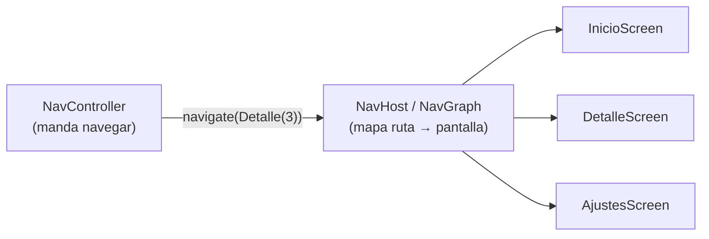

import NextPageButton from '@site/src/components/NextPageButton';

# Navegación (I): NavGraph y rutas tipadas

Hasta ahora cada pantalla ha sido un composable aislado. Una app real tiene **muchas pantallas** y el usuario se mueve entre ellas: de un listado al detalle de un elemento, del detalle de vuelta al listado, a los ajustes... De ese movimiento se encarga la librería **Navigation Compose**.

En esta página se ve la parte básica: qué es el grafo de navegación, cómo se definen las pantallas, cómo se navega y cómo se leen los datos que viajan de una pantalla a otra. La siguiente página cubre el control avanzado de la pila, los intents y la estructura completa de una app.

:::note
Estos apuntes usan **Navigation Compose 2.8 o superior** (la "versión 2" de la librería), que permite definir las rutas como **objetos Kotlin serializables** en lugar de cadenas de texto. Es la forma moderna de hacerlo con esta librería; las rutas en `String` (`"detalle/{id}"`) siguen funcionando, pero son propensas a errores y no se usan aquí.
:::

---

## Las tres piezas

| Pieza | Qué es | Qué hace |
|---|---|---|
| **Ruta** (*route*) | Un `object` o `data class` `@Serializable` | Identifica una pantalla y, si hace falta, transporta sus parámetros |
| **`NavHost`** (el NavGraph) | Un composable | Contiene el **mapa** de rutas → pantallas y dibuja la pantalla actual |
| **`NavController`** | Un objeto | Ejecuta la navegación (`navigate`, `popBackStack`...) y guarda la **pila** de pantallas visitadas |



---

## Dependencias

En `gradle/libs.versions.toml`:

```toml
[versions]
navigation = "2.9.0"
kotlinSerialization = "1.8.1"

[libraries]
androidx-navigation-compose = { module = "androidx.navigation:navigation-compose", version.ref = "navigation" }
kotlinx-serialization-json = { module = "org.jetbrains.kotlinx:kotlinx-serialization-json", version.ref = "kotlinSerialization" }

[plugins]
kotlin-serialization = { id = "org.jetbrains.kotlin.plugin.serialization", version.ref = "kotlin" }
```

En `app/build.gradle.kts`:

```kotlin
plugins {
    // ...los que ya hay
    alias(libs.plugins.kotlin.serialization)
}

dependencies {
    implementation(libs.androidx.navigation.compose)
    implementation(libs.kotlinx.serialization.json)
}
```

Y en el `build.gradle.kts` raíz se declara el plugin con `apply false`, igual que el resto. Las versiones exactas pueden cambiar: se usa la que sugiera Android Studio, siempre que sea **2.8.0 o posterior**.

---

## Paso 1: definir las rutas como objetos

Cada pantalla se representa con un tipo `@Serializable`:

```kotlin
import kotlinx.serialization.Serializable

// Pantallas SIN parámetros → data object
@Serializable data object Inicio
@Serializable data object Ajustes

// Pantallas CON parámetros → data class
@Serializable data class Detalle(val id: Int, val titulo: String)
@Serializable data class Perfil(val nombre: String, val edad: Int? = null)
```

- Una pantalla **sin parámetros** es un `data object`: solo hay una "instancia" posible.
- Una pantalla **con parámetros** es una `data class`: **sus propiedades son los argumentos** de la pantalla. No hay que declarar nada más.
- Un parámetro con valor por defecto o *nullable* (`edad: Int? = null`) es **opcional**.

Frente a las cadenas de texto, esto da seguridad en compilación: si se escribe mal el nombre de una pantalla o se olvida un parámetro, **el código no compila**, en vez de fallar en tiempo de ejecución.

```kotlin
// ❌ Forma antigua: un error tipográfico solo se descubre al ejecutar
navController.navigate("detale/3")

// ✅ Forma tipada: no compila si algo no cuadra
navController.navigate(Detalle(id = 3, titulo = "Fotografía"))
```

:::tip
Es habitual agrupar todas las rutas en un solo fichero `Rutas.kt` (o `Destinos.kt`). Así se ve de un vistazo qué pantallas tiene la app y qué parámetros recibe cada una.
:::

### Qué tipos se pueden usar como parámetro

`Int`, `Long`, `Float`, `Double`, `Boolean`, `String`, los `enum`, y listas o arrays de esos tipos; todos ellos también *nullable*. Un parámetro con **otro tipo propio** (por ejemplo una `data class Usuario`) necesita un `NavType` personalizado, algo que se sale de estos apuntes.

La regla práctica es otra: **no se pasan objetos grandes por la ruta**. Se pasa el **identificador** (`id`) y la pantalla de destino carga los datos desde su `ViewModel` o repositorio. La ruta viaja serializada dentro de la navegación y debe ser ligera.

---

## Paso 2: el NavHost con el mapa de pantallas

```kotlin
import androidx.navigation.compose.NavHost
import androidx.navigation.compose.composable
import androidx.navigation.NavHostController
import androidx.navigation.toRoute

@Composable
fun AppNavGraph(
    navController: NavHostController,
    modifier: Modifier = Modifier
) {
    NavHost(
        navController = navController,
        startDestination = Inicio,          // pantalla inicial: un objeto, no un String
        modifier = modifier
    ) {
        composable<Inicio> {
            InicioScreen(
                onVerDetalle = { id, titulo -> navController.navigate(Detalle(id, titulo)) },
                onAbrirAjustes = { navController.navigate(Ajustes) }
            )
        }

        composable<Detalle> { backStackEntry ->
            val ruta: Detalle = backStackEntry.toRoute()   // leer los parámetros
            DetalleScreen(
                id = ruta.id,
                titulo = ruta.titulo,
                onVolver = { navController.popBackStack() }
            )
        }

        composable<Ajustes> {
            AjustesScreen(onVolver = { navController.popBackStack() })
        }
    }
}
```

Cada `composable<T> { ... }` dice: "cuando la ruta actual sea del tipo `T`, dibuja esto". El tipo `T` **es** la identificación de la pantalla.

El `NavController` se crea una sola vez, en un nivel superior, con `rememberNavController()`:

```kotlin
@Composable
fun MiApp() {
    val navController = rememberNavController()
    AppNavGraph(navController = navController)
}
```

---

## Paso 3: navegar

Se llama a `navigate` con **una instancia de la ruta**:

```kotlin
navController.navigate(Ajustes)                      // sin parámetros
navController.navigate(Detalle(id = 7, titulo = "Montañas"))   // con parámetros
```

No hay que construir ninguna cadena ni codificar nada a mano: la librería serializa los parámetros por su cuenta.

---

## Paso 4: leer los parámetros

Hay dos sitios donde se pueden leer, según dónde viva la lógica de la pantalla.

### Opción A: en el `composable<T>` con `toRoute()`

Es la que se ha visto arriba. El `backStackEntry` que recibe el bloque `composable<Detalle>` representa "esta visita a la pantalla", y `toRoute<Detalle>()` lo convierte de nuevo en el objeto original:

```kotlin
composable<Detalle> { backStackEntry ->
    val ruta: Detalle = backStackEntry.toRoute()
    // ruta.id y ruta.titulo ya están disponibles y tienen su tipo correcto
    DetalleScreen(id = ruta.id, titulo = ruta.titulo, onVolver = { navController.popBackStack() })
}
```

Fíjate en que a `DetalleScreen` **no se le pasa el `backStackEntry`, sino los valores ya leídos**. La pantalla no sabe que existe un sistema de navegación, lo que la hace fácil de probar y de previsualizar con `@Preview`.

### Opción B: en el `ViewModel` con `SavedStateHandle`

Si la pantalla tiene un `ViewModel` (como se vio en [MVVM y remember](/tema-3/h-mvvm-y-remember)), éste puede leer los parámetros directamente, sin que el composable tenga que pasárselos:

```kotlin
class DetalleViewModel(savedStateHandle: SavedStateHandle) : ViewModel() {

    private val ruta: Detalle = savedStateHandle.toRoute<Detalle>()

    private val _uiState = MutableStateFlow(DetalleUiState(titulo = ruta.titulo))
    val uiState: StateFlow<DetalleUiState> = _uiState.asStateFlow()

    init {
        cargarDatos(ruta.id)
    }

    private fun cargarDatos(id: Int) { /* ... */ }
}
```

```kotlin
composable<Detalle> {
    val viewModel: DetalleViewModel = viewModel()   // recibe el SavedStateHandle automáticamente
    val state by viewModel.uiState.collectAsState()
    DetalleScreen(state = state, onVolver = { navController.popBackStack() })
}
```

La opción B es la recomendable cuando la pantalla ya usa un `ViewModel`: así el parámetro llega al sitio donde se necesita y **sobrevive a la rotación** de la pantalla.

---

## No pasar el `NavController` a las pantallas

Observa cómo se ha escrito `InicioScreen`:

```kotlin
@Composable
fun InicioScreen(
    onVerDetalle: (Int, String) -> Unit,   // ← lambda, no NavController
    onAbrirAjustes: () -> Unit
) {
    Column {
        Button(onClick = { onVerDetalle(7, "Montañas") }) { Text("Ver detalle") }
        Button(onClick = onAbrirAjustes) { Text("Ajustes") }
    }
}
```

La pantalla **no recibe el `NavController`**: recibe **lambdas** que describen *qué ha pasado* ("el usuario quiere ver un detalle"), y es el `NavGraph` quien decide *cómo se hace* ("eso es `navController.navigate(Detalle(...))`").

```kotlin
// ❌ Acoplada a la navegación
@Composable
fun InicioScreen(navController: NavController) {
    Button(onClick = { navController.navigate(Ajustes) }) { Text("Ajustes") }
}

// ✅ Independiente de la navegación
@Composable
fun InicioScreen(onAbrirAjustes: () -> Unit) {
    Button(onClick = onAbrirAjustes) { Text("Ajustes") }
}
```

Las ventajas son concretas:

| Con `NavController` en la pantalla | Con lambdas |
|---|---|
| No se puede usar `@Preview` sin crear un `NavController` falso | Basta pasar `{}` en la preview |
| La pantalla conoce todas las rutas de la app | La pantalla solo conoce sus propios eventos |
| Cambiar una ruta obliga a tocar las pantallas | Solo se toca el `NavGraph` |
| Se puede navegar desde cualquier sitio (difícil de seguir) | Toda la navegación está en un único fichero |

```kotlin
@Preview
@Composable
private fun InicioPreview() {
    MiAppTheme {
        InicioScreen(onVerDetalle = { _, _ -> }, onAbrirAjustes = {})
    }
}
```

Es el mismo principio de [MVVM](/tema-3/h-mvvm-y-remember) aplicado a la navegación: el estado **baja** a la pantalla y los eventos **suben** como lambdas.

---

## La pila de pantallas (back stack)

El `NavController` guarda las pantallas visitadas en una **pila**. Cada `navigate` **apila** una pantalla encima; cada "atrás" **desapila** la de arriba y muestra la anterior.

<div style={{textAlign: 'center'}}>
  
</div>

Lo que el usuario ve siempre es la pantalla de la **cima**. Las dos operaciones básicas son:

```kotlin
navController.navigate(Detalle(7))   // apila: la pantalla nueva queda encima

navController.popBackStack()         // desapila: se descarta la pantalla de la cima
```

El botón "atrás" del sistema hace un `popBackStack()` por su cuenta, sin necesidad de programarlo. Cuando la pila se queda con una sola pantalla y el usuario pulsa atrás, la app se cierra.

### `popBackStack()` y `navigateUp()`

Para la flecha "←" de una `TopAppBar` se suele usar `navigateUp()`:

```kotlin
IconButton(onClick = onVolver) {   // onVolver = { navController.navigateUp() } en el NavGraph
    Icon(Icons.AutoMirrored.Filled.ArrowBack, contentDescription = "Volver")
}
```

En una app de una sola Activity, ambas hacen prácticamente lo mismo. La página siguiente explica la diferencia y las opciones avanzadas para controlar qué queda en la pila.

### Ejemplo: seguir lo que ocurre en la pila

```kotlin
// Inicio → Ajustes → Detalle(7)
navController.navigate(Ajustes)
navController.navigate(Detalle(7, "Montañas"))
// pila: [Inicio, Ajustes, Detalle]

navController.popBackStack()
// pila: [Inicio, Ajustes]    ← se ve Ajustes

navController.popBackStack()
// pila: [Inicio]             ← se ve Inicio
```

---

## Resumen

- **Navigation Compose 2.8+** permite usar **objetos `@Serializable`** como rutas: `data object` si no hay parámetros, `data class` si los hay.
- El **`NavHost`** define el mapa con `composable<Ruta> { ... }` y se le indica una `startDestination`.
- Se navega con `navController.navigate(Ruta(...))` y se vuelve con `popBackStack()` o `navigateUp()`.
- Los parámetros se leen con `backStackEntry.toRoute<Ruta>()` o, en el `ViewModel`, con `savedStateHandle.toRoute<Ruta>()`. Se pasa el **identificador**, no objetos grandes.
- Las pantallas **no reciben el `NavController`**, sino **lambdas** (`onVerDetalle`, `onVolver`...). Toda la navegación queda en el `NavGraph`.
- El `NavController` mantiene una **pila**: `navigate` apila, `popBackStack` desapila.

<NextPageButton to="/tema-3/k-navegacion-avanzada">
Navegación (II): control de la pila, intents y estructura de la app
</NextPageButton>
