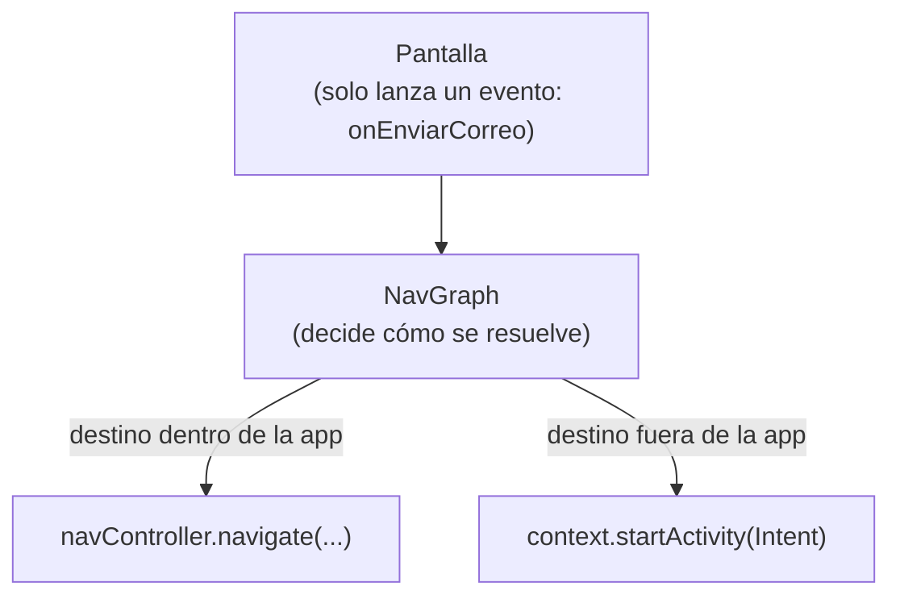

import NextPageButton from '@site/src/components/NextPageButton';

# Navegación (II): la pila, los intents y la estructura de la app

La [página anterior](/tema-3/j-navegacion-basica) cubre lo imprescindible: rutas como objetos, `NavHost`, `navigate`, `popBackStack` y lectura de parámetros. Aquí se ve lo que hace falta en una app real:

1. Controlar **qué se queda en la pila** y qué no (`popUpTo`, `launchSingleTop`...).
2. **Agrupar** pantallas en subgrafos.
3. **Devolver un resultado** a la pantalla anterior.
4. Salir de la app con **intents** (por ejemplo, abrir el correo) sin romper la separación entre pantallas y navegación.
5. Montar la estructura completa **Theme → Drawer → Scaffold → NavGraph → Páginas**.

---

## Controlar la pila con `navigate { ... }`

`navigate` acepta un bloque de opciones que modifica cómo se apila la pantalla nueva.

### `popUpTo`: desapilar al navegar

Caso típico: una pantalla de **login**. Una vez el usuario entra, pulsar "atrás" no debe devolverle al login.

```kotlin
@Serializable data object Login
@Serializable data object Inicio

// Pila antes: [Login]
navController.navigate(Inicio) {
    popUpTo<Login> { inclusive = true }
}
// Pila después: [Inicio]    ← Login ya no está
```

`popUpTo<Login>` desapila **hasta llegar a** `Login`. Con `inclusive = true`, `Login` **también** se desapila; sin él, `Login` se queda en la pila y solo se eliminan las pantallas que hubiera encima.

<div style={{textAlign: 'center'}}>
  
</div>

### `launchSingleTop`: evitar duplicados

Si el usuario pulsa dos veces seguidas el mismo botón, se apilarían dos copias de la misma pantalla. Con `launchSingleTop = true`, si la pantalla de la cima **ya es** la que se pide, no se crea otra:

```kotlin
navController.navigate(Ajustes) {
    launchSingleTop = true
}
// pila: [Inicio, Ajustes]    aunque se llame dos veces
```

### `saveState` y `restoreState`: pestañas que recuerdan su estado

En una barra inferior o un drawer, saltar de sección en sección no debería ir acumulando pantallas en la pila, y al volver a una sección esta debería **conservar** su estado (posición del scroll, texto escrito...). Se consigue combinando tres opciones:

```kotlin
navController.navigate(destino) {
    popUpTo<Inicio> { saveState = true }   // desapila hasta la raíz GUARDANDO el estado de lo desapilado
    launchSingleTop = true                 // sin duplicados
    restoreState = true                    // si ese destino se había guardado, lo restaura
}
```

Este bloque es el que se pone en los elementos de un `NavigationBar` o de un `ModalNavigationDrawer`. Se usa tal cual, sustituyendo `Inicio` por la pantalla raíz de la app.

| Opción | Efecto |
|---|---|
| `popUpTo<T> { }` | Desapila hasta `T` (sin quitar `T`) |
| `popUpTo<T> { inclusive = true }` | Desapila hasta `T` y **también quita `T`** |
| `popUpTo<T> { saveState = true }` | Guarda el estado de las pantallas que se desapilan |
| `launchSingleTop = true` | No apila si la cima ya es el mismo destino |
| `restoreState = true` | Restaura el estado guardado del destino, si existe |

---

## Volver atrás con más control

### `popBackStack<T>()`: volver a una pantalla concreta

```kotlin
// Pila: [Inicio, Lista, Detalle, Editar]

navController.popBackStack<Lista>(inclusive = false)
// Pila: [Inicio, Lista]       ← se vuelve hasta Lista, que se queda

navController.popBackStack<Lista>(inclusive = true)
// Pila: [Inicio]              ← Lista también se quita
```

`popBackStack` **devuelve un `Boolean`**: `true` si ha desapilado algo y `false` si no había nada que quitar (por ejemplo, la ruta no estaba en la pila o ya solo quedaba la pantalla raíz). Sirve para reaccionar a ese caso.

### `popBackStack()` frente a `navigateUp()`

| | `popBackStack()` | `navigateUp()` |
|---|---|---|
| Qué hace | Desapila la pantalla de la cima | Sube un nivel dentro de la app |
| Si la pila queda vacía | Devuelve `false`, no hace nada más | Puede delegar en la Activity (volver a la app de origen) |
| Uso habitual | Botón "Cancelar", "Guardar y volver" | Flecha "←" de la barra superior |

En una app de una sola Activity se comportan casi igual. La diferencia aparece cuando la app se abrió desde fuera (un enlace profundo, una notificación): `navigateUp()` sabe volver al sitio correcto.

### Interceptar el botón atrás: `BackHandler`

Para **impedir** o **cambiar** lo que hace el botón atrás de una pantalla (por ejemplo, avisar de que hay cambios sin guardar):

```kotlin
@Composable
fun EditarScreen(onVolver: () -> Unit) {
    var hayCambios by remember { mutableStateOf(false) }
    var mostrarAviso by remember { mutableStateOf(false) }

    BackHandler(enabled = hayCambios) {
        mostrarAviso = true          // en vez de salir, se pregunta al usuario
    }

    // ... al confirmar el aviso se llama a onVolver()
}
```

`BackHandler` es un composable de `androidx.activity.compose`. Mientras `enabled` sea `true`, **sustituye** al comportamiento por defecto.

### Observar los cambios de pantalla

Útil para depurar o para registrar la navegación:

```kotlin
val navController = rememberNavController()

DisposableEffect(navController) {
    val listener = NavController.OnDestinationChangedListener { _, destino, args ->
        Log.d("NAV", "Ahora en: ${destino.route}")
    }
    navController.addOnDestinationChangedListener(listener)
    onDispose { navController.removeOnDestinationChangedListener(listener) }
}
```

Y para **saber en qué pantalla estamos** desde composables como la barra superior o el drawer:

```kotlin
val backStackEntry by navController.currentBackStackEntryAsState()
val destino = backStackEntry?.destination

val estoyEnAjustes = destino?.hasRoute<Ajustes>() == true
```

`currentBackStackEntryAsState()` es un estado observable: cuando la navegación cambia, lo que dependa de él **se recompone**.

---

## Subgrafos: agrupar pantallas

Cuando varias pantallas forman un **flujo** (un registro en tres pasos, un proceso de compra...), se agrupan en un **grafo anidado** con `navigation<T>`:

```kotlin
@Serializable data object Registro            // identifica el grafo completo
@Serializable data object RegistroDatos       // paso 1
@Serializable data object RegistroContrasena  // paso 2
@Serializable data object RegistroResumen     // paso 3

NavHost(navController, startDestination = Inicio) {
    composable<Inicio> {
        InicioScreen(onRegistrarse = { navController.navigate(Registro) })
    }

    navigation<Registro>(startDestination = RegistroDatos) {
        composable<RegistroDatos> {
            DatosScreen(onSiguiente = { navController.navigate(RegistroContrasena) })
        }
        composable<RegistroContrasena> {
            ContrasenaScreen(onSiguiente = { navController.navigate(RegistroResumen) })
        }
        composable<RegistroResumen> {
            ResumenScreen(
                onTerminar = {
                    // Salir del flujo completo de una vez
                    navController.navigate(Inicio) {
                        popUpTo<Registro> { inclusive = true }
                    }
                }
            )
        }
    }
}
```

Dos ventajas: navegar a `Registro` **entra directamente en su pantalla inicial**, y `popUpTo<Registro> { inclusive = true }` **quita de la pila todas las pantallas del flujo** con una sola línea, sin tener que enumerarlas.

---

## Devolver un resultado a la pantalla anterior

Un caso frecuente: desde un formulario se abre un selector (de fecha, de país...) y al elegir hay que **devolver el valor** al formulario. Se hace a través del `savedStateHandle` de la entrada de la pila.

**La pantalla que elige** escribe el resultado en la entrada **anterior** y vuelve:

```kotlin
composable<SelectorPais> {
    SelectorPaisScreen(
        onElegido = { pais ->
            navController.previousBackStackEntry
                ?.savedStateHandle
                ?.set("pais", pais)
            navController.popBackStack()
        }
    )
}
```

**La pantalla que pidió el dato** lo lee como un estado observable:

```kotlin
composable<Formulario> { entry ->
    val pais by entry.savedStateHandle
        .getStateFlow<String?>("pais", null)
        .collectAsState()

    FormularioScreen(
        pais = pais,
        onElegirPais = { navController.navigate(SelectorPais) }
    )
}
```

:::note
Aquí la clave `"pais"` sí es un `String` y se escribe a mano. Es una de las pocas veces en que aparece, y es un buen motivo para guardarla en una constante (`const val CLAVE_PAIS = "pais"`).
:::

---

## Abrir otras apps: los intents desde el NavGraph

No todo "ir a otra pantalla" es una pantalla **de nuestra app**. A veces hay que abrir el **cliente de correo**, el navegador, el marcador del teléfono... Eso se hace con un **`Intent`**, que **no pasa por el `NavController`**.



La idea es la misma que con las rutas: la pantalla **no sabe** si el evento se resuelve navegando a otra pantalla propia o abriendo otra aplicación; **solo recibe una lambda**. El `NavGraph` es el único lugar que conoce el `Context` y construye el `Intent`.

:::note
**Explícito o implícito.** Un intent es **explícito** cuando nombra la clase que debe abrir (`Intent(context, OtraActivity::class.java)`) e **implícito** cuando solo describe la **acción** (enviar un correo, abrir una web) y es el sistema quien elige la app que la atiende. Abrir el correo es un intent **implícito**; un intent explícito se usa para abrir otra Activity de nuestra propia app. Se ven ambos a continuación.
:::

### Intents en funciones aparte

Para no llenar el `NavGraph` de código de `Intent`, se agrupan en un fichero `Intents.kt`:

```kotlin
import android.content.ActivityNotFoundException
import android.content.Context
import android.content.Intent
import android.net.Uri
import android.widget.Toast

fun Context.enviarCorreo(destinatario: String, asunto: String, cuerpo: String = "") {
    val intent = Intent(Intent.ACTION_SENDTO).apply {
        data = Uri.parse("mailto:")                       // solo apps de correo
        putExtra(Intent.EXTRA_EMAIL, arrayOf(destinatario))
        putExtra(Intent.EXTRA_SUBJECT, asunto)
        putExtra(Intent.EXTRA_TEXT, cuerpo)
    }
    abrirSeguro(intent)
}

fun Context.abrirUrl(url: String) {
    abrirSeguro(Intent(Intent.ACTION_VIEW, Uri.parse(url)))
}

// Intent EXPLÍCITO: abre otra Activity de nuestra propia app
fun Context.abrirActividadAyuda() {
    startActivity(Intent(this, AyudaActivity::class.java))
}

private fun Context.abrirSeguro(intent: Intent) {
    try {
        startActivity(intent)
    } catch (e: ActivityNotFoundException) {
        Toast.makeText(this, "No hay ninguna app para esta acción", Toast.LENGTH_SHORT).show()
    }
}
```

Se captura `ActivityNotFoundException` porque no hay garantía de que el dispositivo tenga una app que atienda la acción (un emulador sin cliente de correo, por ejemplo).

### Usar el correo desde el NavGraph

Con la función `enviarCorreo` ya escrita, el `NavGraph` solo tiene que obtener el `Context` y conectar la lambda de la pantalla con ella:

```kotlin
@Composable
fun AppNavGraph(
    navController: NavHostController,
    modifier: Modifier = Modifier
) {
    val context = LocalContext.current       // el Context se obtiene UNA vez, aquí

    NavHost(navController, startDestination = Inicio, modifier = modifier) {

        composable<Contacto> {
            ContactoScreen(
                onEnviarCorreo = {
                    context.enviarCorreo(
                        destinatario = "soporte@ejemplo.com",
                        asunto = "Consulta desde la app"
                    )
                },
                onVolver = { navController.popBackStack() }   // navegación interna
            )
        }
    }
}
```

Dentro del mismo `composable<Contacto>` conviven dos tipos de salida: `onVolver` se resuelve con el `NavController` (se queda dentro de la app) y `onEnviarCorreo` con un `Intent` (sale de la app). Para la pantalla son **iguales**: dos lambdas.

```kotlin
@Composable
fun ContactoScreen(
    onEnviarCorreo: () -> Unit,
    onVolver: () -> Unit
) {
    Column(Modifier.padding(16.dp)) {
        Text("¿Necesitas ayuda?", style = MaterialTheme.typography.titleLarge)
        Button(onClick = onEnviarCorreo) { Text("Escribir al soporte") }
        TextButton(onClick = onVolver) { Text("Volver") }
    }
}
```

Si el asunto o el destinatario dependen de un parámetro de la ruta, se leen en el `NavGraph` con `toRoute()` y se pasan a la función del intent:

```kotlin
@Serializable data class Incidencia(val id: Int, val titulo: String)

composable<Incidencia> { entry ->
    val ruta: Incidencia = entry.toRoute()
    IncidenciaScreen(
        titulo = ruta.titulo,
        onReportar = {
            context.enviarCorreo(
                destinatario = "soporte@ejemplo.com",
                asunto = "Incidencia #${ruta.id}: ${ruta.titulo}"
            )
        }
    )
}
```

:::tip
En el emulador puede no haber ninguna app de correo configurada; en ese caso `abrirSeguro` muestra el aviso en lugar de cerrar la app. Para probarlo de verdad, usa un dispositivo con Gmail instalado.
:::

---

## Estructura completa de una app

Para terminar, se reúne todo en una estructura con esta jerarquía:

<div style={{textAlign: 'center'}}>
  
</div>

El **`NavController` se crea en `AppRoot`**, que es donde conviven el drawer, el `Scaffold` y el `NavGraph`, y por tanto los tres lo necesitan. Las **páginas** quedan fuera: solo reciben lambdas.

### Organización de ficheros

```
app/src/main/java/com/ejemplo/miapp/
├── MainActivity.kt          ← Theme + AppRoot
├── ui/
│   ├── theme/               ← MiAppTheme (Color.kt, Theme.kt, Type.kt)
│   ├── AppRoot.kt           ← Drawer + Scaffold
│   ├── navigation/
│   │   ├── Rutas.kt         ← los @Serializable
│   │   ├── AppNavGraph.kt   ← el NavHost
│   │   └── Intents.kt       ← funciones de Context que lanzan intents
│   └── pantallas/
│       ├── InicioScreen.kt
│       ├── DetalleScreen.kt
│       ├── ContactoScreen.kt
│       └── AjustesScreen.kt
```

### `Rutas.kt`

```kotlin
@Serializable data object Inicio
@Serializable data class Detalle(val id: Int, val titulo: String)
@Serializable data object Contacto
@Serializable data object Ajustes
```

### `MainActivity.kt`: el Theme

```kotlin
class MainActivity : ComponentActivity() {
    override fun onCreate(savedInstanceState: Bundle?) {
        super.onCreate(savedInstanceState)
        enableEdgeToEdge()
        setContent {
            MiAppTheme {          // 1. Theme: envuelve TODO
                AppRoot()
            }
        }
    }
}
```

### `AppRoot.kt`: el Drawer y el Scaffold

```kotlin
private data class OpcionMenu(
    val etiqueta: String,
    val icono: ImageVector,
    val ruta: Any
)

private val opcionesMenu = listOf(
    OpcionMenu("Inicio", Icons.Default.Home, Inicio),
    OpcionMenu("Contacto", Icons.Default.Email, Contacto),
    OpcionMenu("Ajustes", Icons.Default.Settings, Ajustes)
)

@OptIn(ExperimentalMaterial3Api::class)
@Composable
fun AppRoot() {
    val navController = rememberNavController()
    val drawerState = rememberDrawerState(DrawerValue.Closed)
    val scope = rememberCoroutineScope()

    val backStackEntry by navController.currentBackStackEntryAsState()
    val destino = backStackEntry?.destination

    // 2. Menú Drawer: envuelve al Scaffold
    ModalNavigationDrawer(
        drawerState = drawerState,
        drawerContent = {
            ModalDrawerSheet {
                Text("Mi App", modifier = Modifier.padding(16.dp), style = MaterialTheme.typography.titleLarge)
                opcionesMenu.forEach { opcion ->
                    NavigationDrawerItem(
                        label = { Text(opcion.etiqueta) },
                        icon = { Icon(opcion.icono, contentDescription = null) },
                        selected = destino?.hasRoute(opcion.ruta::class) == true,
                        onClick = {
                            scope.launch { drawerState.close() }
                            navController.navigate(opcion.ruta) {
                                popUpTo<Inicio> { saveState = true }
                                launchSingleTop = true
                                restoreState = true
                            }
                        }
                    )
                }
            }
        }
    ) {
        // 3. Scaffold: barra superior + hueco para el contenido
        Scaffold(
            topBar = {
                val enDetalle = destino?.hasRoute<Detalle>() == true
                TopAppBar(
                    title = { Text("Mi App") },
                    navigationIcon = {
                        if (enDetalle) {
                            IconButton(onClick = { navController.navigateUp() }) {
                                Icon(Icons.AutoMirrored.Filled.ArrowBack, contentDescription = "Volver")
                            }
                        } else {
                            IconButton(onClick = { scope.launch { drawerState.open() } }) {
                                Icon(Icons.Default.Menu, contentDescription = "Abrir menú")
                            }
                        }
                    }
                )
            }
        ) { padding ->
            // 4. NavGraph: dibuja la página actual dentro del hueco del Scaffold
            AppNavGraph(
                navController = navController,
                modifier = Modifier.padding(padding)
            )
        }
    }
}
```

Puntos clave:

- El **drawer** y el **`Scaffold`** usan el `NavController` para `navigate`, `navigateUp` y para saber la pantalla actual (`selected`, icono de la barra).
- El menú lateral usa el bloque `popUpTo { saveState } + launchSingleTop + restoreState` explicado antes, para que cambiar de sección no acumule pantallas.
- El `padding` que entrega el `Scaffold` se aplica al `NavHost`, de modo que **todas las páginas** respetan la barra superior sin que ninguna tenga que ocuparse.

### `AppNavGraph.kt`: el único sitio que conoce rutas e intents

```kotlin
@Composable
fun AppNavGraph(
    navController: NavHostController,
    modifier: Modifier = Modifier
) {
    val context = LocalContext.current

    NavHost(
        navController = navController,
        startDestination = Inicio,
        modifier = modifier
    ) {
        composable<Inicio> {
            InicioScreen(
                onVerDetalle = { id, titulo -> navController.navigate(Detalle(id, titulo)) }
            )
        }

        composable<Detalle> { entry ->
            val ruta: Detalle = entry.toRoute()
            DetalleScreen(id = ruta.id, titulo = ruta.titulo)
        }

        composable<Contacto> {
            ContactoScreen(
                onEnviarCorreo = { context.enviarCorreo("soporte@ejemplo.com", "Consulta") }
            )
        }

        composable<Ajustes> {
            AjustesScreen(onAbrirAyuda = { context.abrirActividadAyuda() })
        }
    }
}
```

### Una página: no sabe nada de todo lo anterior

```kotlin
@Composable
fun InicioScreen(onVerDetalle: (Int, String) -> Unit) {
    LazyColumn {
        items(listaDeElementos) { elemento ->
            ListItem(
                headlineContent = { Text(elemento.titulo) },
                modifier = Modifier.clickable { onVerDetalle(elemento.id, elemento.titulo) }
            )
        }
    }
}
```

Esta función no importa nada de `androidx.navigation`. Se puede previsualizar, probar y reutilizar sin tocar la navegación.

### Quién conoce qué

| Capa | Conoce | No conoce |
|---|---|---|
| **Theme** | Colores y tipografía | Navegación |
| **AppRoot** (Drawer + Scaffold) | `NavController`, la pantalla actual, las opciones del menú | El contenido de las páginas |
| **AppNavGraph** | Todas las rutas y los intents | Cómo se dibuja cada página por dentro |
| **Páginas** | Sus datos y sus lambdas | `NavController`, rutas, `Context` para intents |

---

## Resumen

- `navigate { popUpTo<T> { inclusive = true } }` quita pantallas de la pila al navegar (típico: login → inicio). `launchSingleTop` evita duplicados y `saveState` + `restoreState` conservan el estado de cada sección.
- `popBackStack<T>()` vuelve a una pantalla concreta; devuelve `Boolean`. `navigateUp()` es la acción de la flecha "←". `BackHandler` intercepta el botón atrás.
- `navigation<T>(startDestination = ...)` agrupa pantallas en un **subgrafo** y permite salir del flujo entero con un solo `popUpTo`.
- Un resultado se devuelve con `previousBackStackEntry?.savedStateHandle?.set(...)` y se lee con `getStateFlow(...)`.
- Los **intents** (correo, URL...) **no pasan por el `NavController`**: se lanzan con `context.startActivity(...)` **desde el `NavGraph`**, y la pantalla solo recibe la lambda.
- La estructura completa es **Theme → Drawer → Scaffold → NavGraph → Páginas**: el `NavController` vive en `AppRoot`, y las páginas solo reciben datos y lambdas.

<NextPageButton to="/tema-3/f-mockup-catalogo-apps">
Leer un mockup: catálogo de aplicaciones
</NextPageButton>
